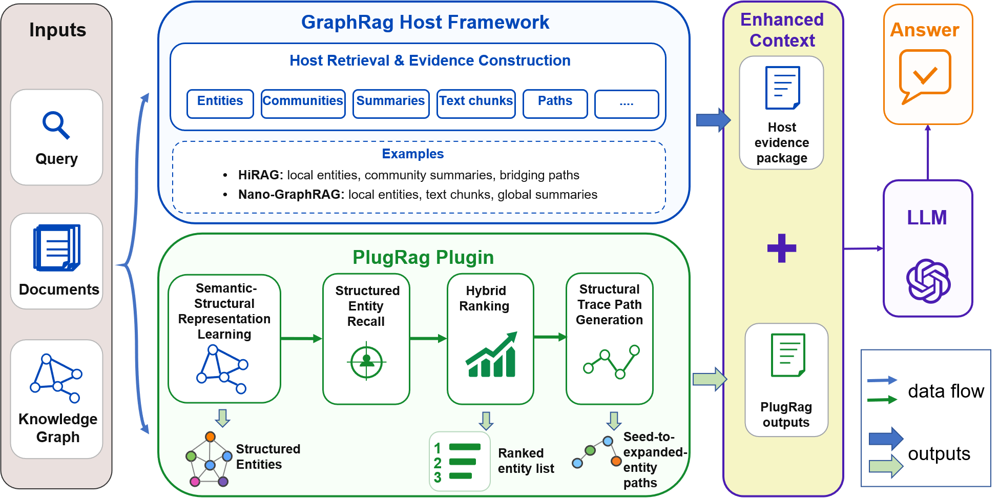

# PlugRag

**PlugRag: A Plug-and-Play Graph Retrieval Enhancement Method Integrating Semantic and Structural Representations**

[Chinese README](README_zh.md)

PlugRag is a plug-and-play entity-level graph retrieval enhancement method for KG-enhanced retrieval-augmented generation. It does not replace the indexing, graph construction, or generation workflow of the host RAG framework. Instead, it adds semantic-structural entity representations, structured entity recall, hybrid ranking, and structural trace paths during entity retrieval and context construction.

<p align="center">
  
</p>

## Overview

Existing KG-enhanced RAG systems often retrieve entities through semantic similarity, neighborhood expansion, or path search. These mechanisms can improve evidence coverage, but they may also introduce weakly related neighbors, redundant paths, or miss important intermediate entities. PlugRag addresses this issue as a non-intrusive enhancement layer that can be attached to graph-based RAG frameworks such as HiRAG and Nano-GraphRAG.

PlugRag consists of four main components:

- **Semantic-Structural Representation**: initialize entities with text embeddings from entity names and descriptions, then inject graph topology and relation-type information with GCN / R-GCN encoders.
- **Structured Entity Recall**: use high-confidence semantic entities as seeds and expand structurally related entities in the graph-encoder representation space.
- **Hybrid Ranking**: combine semantic filtering, structural voting frequency, and Cross-Encoder reranking to reduce structural noise.
- **Structural Trace Path**: generate relation paths from semantic seeds to expanded entities, making expanded evidence more interpretable.

## Repository Structure

```text
github_code_release_20260619/
|-- HiRAG-PlugRag/
|   |-- hirag/
|   |-- evel/
|   |-- config.example.yaml
|   |-- environment.yml
|-- Nano-GraphRAG-PlugRag/
|   |-- nano_graphrag/
|   |-- evel/
|   |-- config_example.yaml
|   |-- environment.yml
|-- paper_results/
|   |-- raw/
|   |-- experiments.json
|   |-- files.json
|   `-- audit.py
|-- assets/
|   `-- figure2-plugrag-overview.png
`-- README_zh.md
```

The two backbone implementations can be used independently. Installation, configuration, training, inference, and evaluation instructions are collected below.

## Non-Intrusive Integration

PlugRag is designed as a non-intrusive module:

- It keeps the original document chunking, entity-relation extraction, knowledge graph construction, and LLM generation workflow.
- It does not rewrite the global retrieval logic of HiRAG or Nano-GraphRAG.
- It only enhances local entity retrieval and context construction.
- Graph encoder variants are selected through configuration and checkpoint paths instead of separate query modes.

PlugRag provides three query modes:

- `plugrag_full`: full PlugRag with structural expansion, hybrid ranking, and trace/path context.
- `plugrag_rank_only`: semantic ranking ablation without graph-encoder structural expansion.
- `plugrag_vote_only`: structural voting ablation without semantic reranking fusion.

HiRAG also includes `hi_ppr_top3` and `pathrag_evidence_aligned` for controlled PPR-based and PathRAG-style retrieval comparisons. These modes reuse the HiRAG graph and answer-generation pipeline; they are retrieval-strategy adaptations, not the complete HippoRAG or PathRAG systems. Set `batch_query.graph_encoder` to `none` for these two modes. Their implementations are `HiRAG-PlugRag/hirag/ppr_top3.py` and `HiRAG-PlugRag/hirag/pathrag_evidence_aligned.py`.

## Installation

Python 3.10 is recommended.

HiRAG version:

```bash
cd HiRAG-PlugRag
conda env create -f environment.yml
conda activate plugrag-hirag
python -m pip install --upgrade pip setuptools wheel
pip install -r requirements.txt
pip install -e .
```

Nano-GraphRAG version:

```bash
cd Nano-GraphRAG-PlugRag
conda env create -f environment.yml
conda activate plugrag-nano
python -m pip install --upgrade pip setuptools wheel
pip install -r requirements.txt
pip install -e .
```

If you need a CUDA build of PyTorch, install the matching PyTorch package first and then install `requirements.txt`. Optional Nano backends such as HNSW, Ollama, Qdrant, Milvus, and DSPy are listed in `Nano-GraphRAG-PlugRag/requirements-optional.txt`.

## Configuration

Copy the example configuration before running experiments:

```bash
cp HiRAG-PlugRag/config.example.yaml HiRAG-PlugRag/config.local.yaml
cp Nano-GraphRAG-PlugRag/config_example.yaml Nano-GraphRAG-PlugRag/config_local.yaml
```

Windows PowerShell:

```powershell
copy HiRAG-PlugRag/config.example.yaml HiRAG-PlugRag/config.local.yaml
copy Nano-GraphRAG-PlugRag/config_example.yaml Nano-GraphRAG-PlugRag/config_local.yaml
$env:PLUGRAG_CONFIG="config.local.yaml" # HiRAG; use config_local.yaml for Nano
$env:OPENAI_API_KEY="your_api_key"
$env:OPENAI_BASE_URL="https://api.siliconflow.cn/v1"
```

Linux / macOS:

```bash
export OPENAI_API_KEY=your_api_key
export OPENAI_BASE_URL=https://api.siliconflow.cn/v1
export PLUGRAG_CONFIG=config.local.yaml # HiRAG; use config_local.yaml for Nano
```

In the paper experiments, BGE-M3 is used for initial entity semantic embeddings, R-GCN / Simple GCN / Multi-edge R-GCN+TransE are used as graph encoder variants, and BGE-Reranker-v2-M3 is used for reranking.

Before training or querying, prepare the host framework's graph and index. HiRAG uses `hirag.working_dir`; Nano uses `storage.working_dir`. Nano can build an index from a corpus through `indexing.context_file` and `indexing.insert_before_training`. Set model endpoints, embedding/mapping paths, and query/output paths in the local YAML. The commands below assume an existing compatible graph/index.

## Training

### HiRAG

Convert GraphML to graph encoder training data:

```bash
cd HiRAG-PlugRag
python -m hirag.convert_graphml_to_rgcn_data --input work_dir_data_mix/graph_chunk_entity_relation_02.graphml --output work_dir_data_mix/rgcn/rgcn_data.pt
python -m hirag.convert_graphml_to_simple_gcn_data --input work_dir_data_mix/graph_chunk_entity_relation_02.graphml --output work_dir_data_mix/gcn/gcn_data.pt
python -m hirag.convert_graphml_to_multi_edge_rgcn_data --input work_dir_data_mix/graph_chunk_entity_relation_02.graphml --output work_dir_data_mix/multi_edge/multi_edge_rgcn_data.pt
```

Train graph encoders:

```bash
python -m hirag.train_plugrag_rgcn_encoder
python -m hirag.train_simple_gcn_ablation
python -m hirag.train_multi_edge_rgcn_transe_ablation
```

### Nano-GraphRAG

Convert training data from an existing Nano working directory or GraphML:

```bash
cd Nano-GraphRAG-PlugRag
python prepare_plugrag_training_data.py --config config_example.yaml --encoder all
```

Train graph encoders:

```bash
python train_plugrag_rgcn_encoder.py --config config_example.yaml
python train_simple_gcn_ablation.py --config config_example.yaml
python train_multi_edge_rgcn_transe_ablation.py --config config_example.yaml
```

## Question Answering

Batch QA is controlled by the `batch_query` section in YAML:

```yaml
batch_query:
  input_file: "queries.jsonl"
  output_file: "answers.jsonl"
  concurrency: 5
  mode: "plugrag_full"
  graph_encoder: "rgcn"
  top_k: 20
```

HiRAG:

```bash
cd HiRAG-PlugRag
python hi_batch_query.py
```

Nano-GraphRAG:

```bash
cd Nano-GraphRAG-PlugRag
python hi_batch_query.py
```

For ablations, keep the query mode simple and switch the encoder checkpoint paths. For example, Simple GCN still runs through `plugrag_full`; HiRAG can use `batch_query.graph_encoder: "simple_gcn"`, while Nano can point `storage.rgcn_embeddings_file` and `storage.rgcn_mapping_file` to the Simple GCN files.

## Evaluation

Experiments are conducted on four subsets of [UltraDomain](https://huggingface.co/datasets/TommyChien/UltraDomain):

- Mix
- CS
- Legal
- Agriculture

The updated paper answers and evaluation records are organized under:

```text
paper_results/raw/HiRAG-PlugRag/evel/datasets/
paper_results/raw/Nano-GraphRAG-PlugRag/evel/datasets/
```

`paper_results/experiments.json` maps comparisons to evaluation files and answer order; `paper_results/files.json` records source paths and checksums. Use these mappings for the revised results; the original `evel/` directories also contain older batches. The supplemental Mix Full answer file retains `candidate` in its name because its exact historical batch identity is unverified.

Check the archived files and reported percentages without API calls, from the repository root:

```bash
python paper_results/audit.py
python -m unittest discover -s paper_results/tests -q
```

To run new pairwise evaluations, execute the following from either backbone directory:

```bash
cp evel/evaluation_code/eval_config.example.yaml evel/evaluation_code/eval_config.yaml
python evel/evaluation_code/batch_eval.py --help
```

The evaluation script also accepts `PLUGRAG_EVAL_CONFIG` if you prefer to keep API credentials outside the repository.

The evaluation dimensions are:

- Comprehensiveness
- Empowerment
- Diversity
- Overall Winner

The paper uses bidirectional position-swapped pairwise evaluation to reduce answer-order bias.

As confirmed by the authors, answer generation uses DeepSeek-V3. Cross-framework comparisons are judged by Pro; within-framework comparisons, PPR/PathRAG comparisons, and ablations are judged by DeepSeek-R1. Generation and judging are separate stages. Historical filenames are retained and are not authoritative model identifiers; reported judges are recorded in `paper_results/experiments.json`.

## Reproducibility Notes

- Public configuration files do not contain private API keys.
- Updated answer and evaluation JSONL files are mapped in `paper_results/experiments.json`.
- Generated training checkpoints and local working directories are intentionally excluded by `.gitignore`; users can regenerate them from the provided conversion and training scripts.
- API-dependent QA and LLM-as-a-judge evaluation require valid API credentials and may produce small variations if the provider changes model behavior.
- Example configurations are starting points for new runs, not records of every historical experiment. Offline result checks do not reproduce API generation or establish exact historical model identity.

Code tests can be run from `HiRAG-PlugRag` using `python -m pytest -q tests`.

## Main Findings

Across the four UltraDomain subsets, PlugRag generally provides positive but modest gains. The R-GCN variant is relatively stable across both HiRAG and Nano-GraphRAG. Simple GCN and Multi-edge GCN are more sensitive to dataset structure, relation-label quality, and graph connectivity. Ablation studies indicate that semantic-structural representation, hybrid ranking, and structural trace paths help reduce structural noise and improve evidence organization.

## Acknowledgements

This repository builds on and sincerely thanks the following open-source projects:

- [hhy-huang/HiRAG](https://github.com/hhy-huang/HiRAG)
- [gusye1234/nano-graphrag](https://github.com/gusye1234/nano-graphrag)

We also thank the creators of [UltraDomain](https://huggingface.co/datasets/TommyChien/UltraDomain) for providing the benchmark used in the experiments.
